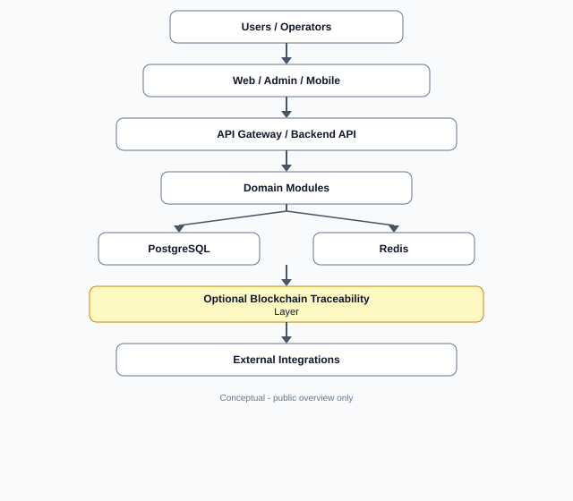

# 0xVera Trace

Modular SaaS platform for logistics, inventory, orders, transport, and traceability, with multi-tenant isolation and per-module licensing. The system is delivered as a **strict polyrepo**: separate repositories for API, web portal, admin, Android, shared packages, and deployment orchestration.

Delivered as a containerized stack and under active development, with frequent releases.

> Public overview repository. Source code and production infrastructure are private.

See [CHANGELOG.md](./CHANGELOG.md) for the revision history of this overview.

## What it does

- Provides a **single HTTP API** (OpenAPI / Swagger as the contract) consumed by the web portal, admin, Android app, and integrations.
- Separates the **tenant-facing** experience from an **internal admin** surface (different client applications, aligned to the same API).
- Models **identity, tenancy, licensing, and modules** so capabilities can be enabled per tenant without exposing unrelated features.
- Covers operational domains such as inventory, warehouses, orders, picking and shipping, transport, proof of delivery, traceability events, waste tracking, and billing.
- Ships **deployment orchestration** (edge reverse proxy, service wiring) as its own component alongside the application repos.

## Why it exists

Organizations need one coherent operational stack for stock, fulfilment, and traceability instead of ad-hoc spreadsheets and disconnected tools, and they increasingly need to prove what happened to a product, an order, or a waste batch. The design targets **B2B SaaS**: clear tenancy, commercial module boundaries, and a stable API for long-lived integrations and field clients.

## Key Features

Implemented today:

- **Authentication** with JWT access tokens and refresh token rotation and revocation.
- **Multi-tenant** data model with tenant isolation enforced in the database through PostgreSQL row-level security.
- **Role-based access control** with 9 roles, from platform administration to tenant operations and field users.
- **Per-module licensing** so features are gated by license, not only by UI.
- **OpenAPI-first** backend contract for all first-party clients.
- **Inventory** - products, warehouses, locations, stock levels, movements, and reservations.
- **Orders** with a state workflow, plus **picking, packing, shipping, and delivery**, carriers, and shipments.
- **Proof of delivery** - GPS position, signature, and photo evidence, with configurable policy enforcement.
- **Traceability event log** available through the API and the web portal (an operational record, not a legal ledger).
- **Waste tracking MVP** with chain-of-custody records.
- **Billing MVP** with Stripe Checkout.
- **Webhooks**, an **analytics dashboard**, and **media upload**.
- **Android field app** - offline-first, with QR / barcode scanning, an offline outbox with sync, GPS capture, and signature capture.
- **Localization** - 7 UI languages, including Catalan.
- **Polyrepo governance** per component: independent versioning, CI, and release lines (no monorepo at workspace root).

## Roadmap

The following items are **not implemented yet**:

- **Blockchain traceability anchoring (design phase).** A network-agnostic anchoring layer: SHA-256 digests of traceability events, proof-of-delivery evidence, and waste custody records would be anchored on a network chosen by each client. Candidate networks include the NCGEP Enterprise Domain (an open Cosmos SDK network), Polkadot, Stellar, or a client's own chain. No personal data is stored on-chain; only digests.
- **Reseller hierarchy and branding** (partially designed, not complete).
- **Advanced lots and serial numbers.**
- **End-to-end tests and observability.**

## Architecture Overview

- **API / Backend** - REST API, authorization, domain modules, OpenAPI/Swagger, persistence on PostgreSQL.
- **Web portal** - React SPA for tenant and end-user workflows.
- **Admin** - React administrative SPA served separately from the web portal behind the edge proxy.
- **Mobile** - Android application consuming the same API contract, designed to work offline.
- **Shared packages** - TypeScript types and DTOs shared across services and clients (consumption strategy is versioned; details are private).
- **Orchestration / edge** - Docker Compose stack with an Nginx edge proxy routing to the API, admin, and web portal (`0xvera-trace-orch`, private).
- **Data layer** - PostgreSQL with row-level security. Redis is currently disabled and remains an optional, future component for cache or queues.
- **Automation layer** - Background work runs inside the API service today; exact topology is intentionally not specified here.

## Architecture Diagram

High-level data and control flow (conceptual; not a deployment map).

## Tech Stack

Verified from the private polyrepo (representative, not exhaustive):

- **Backend:** Node.js 24 LTS line, TypeScript 7, Express 5, Drizzle ORM, PostgreSQL 16, Zod 4, OpenAPI / Swagger UI, Vitest.
- **Frontends:** React 19 + Vite SPAs (web portal and admin), react-i18next for localization.
- **Mobile:** Android, Kotlin + Jetpack Compose, CameraX and ML Kit for scanning.
- **Platform:** Docker Compose, Nginx at the edge, Cosign keyless container image signing.
- **CI / maintenance:** GitHub Actions, Dependabot.

## Current Status

**In active development, with frequent releases.**

Current component lines: API v1.28, web portal v2.5, admin v1.7, Android v1.7.

This is a **modular product** under continuous engineering: architecture, domain boundaries, and phased delivery are documented in private repositories. It is **not** a throwaway demo or an abandoned concept; scope grows in controlled phases while keeping contracts and tenancy explicit.

## Screenshots / Demo

<!--
Add screenshots or GIFs here:

-->

## Notes

This repository is a public overview only. The source code, deployment details, hostnames, registry configuration, and private infrastructure are not exposed.

## Contact

LinkedIn:  
https://www.linkedin.com/in/joel-domenech/
